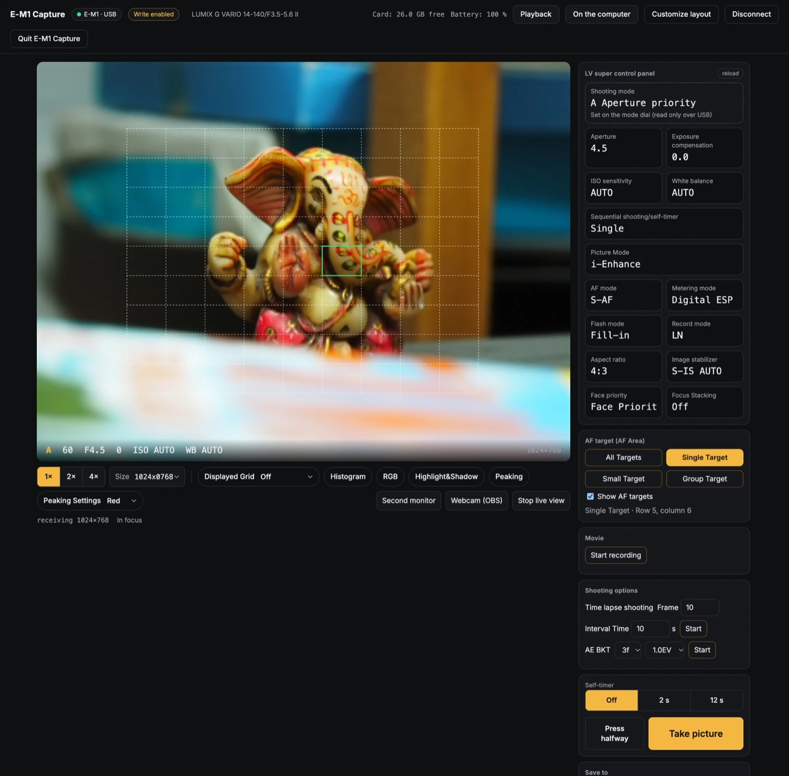

# E-M1 Capture

**Control your Olympus OM-D E-M1 (Mark I) from your computer – over the camera's own Wi-Fi or a USB cable.**

Big live view, tap to focus, all main settings, playback and saving to the computer – in your browser,
on your own computer, without the internet. A new life for a great classic camera.

> Unofficial project. Not affiliated with, endorsed by or supported by OM Digital Solutions or
> Olympus. "Olympus", "OM-D" and "OI.Share" are trademarks of their respective owners.
> Use at your own risk.



*E-M1 Capture with the E-M1 Mark I over USB: live view, AF grid (focused field in green) and the LV super control panel.*

## Highlights

**See and focus**
- **Live view at 30 fps** over USB, sizes up to 1280×960 – with histogram, Highlight&Shadow, peaking and grid.
- **Tap to focus** on the 9×9 AF grid in about half a second; green frame when it is sharp.
- **Star AF** for the night sky: measures star size live, focuses by itself over USB and locks the focus.
- **Focus ring and Focus Stacking** from the computer (USB).
- **Level gauge** with horizon line and an optional "level" sound (USB).

**Shoot**
- **Wi-Fi tethering on the computer** – something Olympus never offered. No special cable needed.
- **LV super control panel:** shutter speed, aperture, ISO, WB, Picture Mode, Art filter and more – only where the camera allows them.
- **Mode dial follows instantly:** turn the dial and the app shows the new mode in under a second (USB).
- **No card? No problem:** over USB pictures go straight to the computer.
- **BULB, LIVE TIME, LIVECOMP**, self-timer, time lapse, AE BKT and movie recording.

**Look at your pictures**
- **Playback** with Index and Calendar display, shooting data, pinch zoom and swipe.
- **Copy to the computer** while you shoot, or save pictures from the card later.
- **HSL color profiles** inspired by the PEN-F COLOR mode, with a before/after view.

**Beyond the camera**
- **Use it on a phone** in your home Wi-Fi – scan a QR code, done.
- **Webcam for OBS**, Zoom and Teams; **second monitor** for the live view.
- **AI Photo Coach:** Claude and other AI assistants can look at the live view and your last shot and suggest settings.

**Safe and free**
- Never touches the firmware, starts **read only**, works **offline**, stays on your computer.
- Open source (GPL-3.0). Built for the E-M1 Mark I; users report it works with the **PEN-F**, too.

## Quick start

```sh
git clone https://github.com/HolmHaensel/omcap.git
cd omcap
python3 -m venv .venv
.venv/bin/pip install ".[usb]"     # Wi-Fi and USB (Wi-Fi only: .venv/bin/pip install .)
```

1. Connect the camera [over Wi-Fi](#using-wi-fi) or [over USB](#using-usb).
2. **Double-click** `E-M1 Capture.command` (macOS). The browser opens at `http://127.0.0.1:8765`.
3. Click **Connect** – or wait: the app connects by itself to the camera used last time.

More in [Start and stop](#start-and-stop).

## What it can do

✅ tested on the camera · 🟡 built, not tested on the camera yet · – not possible

| | Wi-Fi | USB |
|---|---|---|
| Live view, zoom, histogram, peaking, grid | ✅ | ✅ |
| Tap to focus on the 9×9 AF grid | ✅ | ✅ |
| AF Area, focus ring, Focus Stacking, level gauge | – | ✅ |
| Star AF (live star-size aid) | 🟡 | ✅ |
| Auto Star AF with Focus Lock | – | ✅ |
| Take picture, Press halfway, self-timer, BULB/LIVE TIME/LIVECOMP | ✅ | ✅ |
| Movie recording | ✅ | ✅ |
| LV super control panel (exposure, ISO, WB, Picture Mode, drive) | ✅ | ✅ |
| Set the shooting mode from the computer | ✅ | – (mode dial, follows in < 1 s) |
| AF mode, metering, flash, record mode, aspect, stabilizer | – | ✅ |
| Playback, shooting data, save to computer | ✅ | ✅ |
| Erase pictures on the card | – | ✅ |
| Shoot without a card, straight to the computer | – (needs a card) | ✅ |
| Phone view, second monitor, webcam (OBS) | ✅ | ✅ |
| AI Photo Coach (MCP) | ✅ | ✅ |

Every feature with details and test notes: **[FEATURES.md](FEATURES.md)**.

**Not possible with the E-M1 Mark I:** level gauge, AF Area, Focus Stacking and the focus ring over Wi-Fi;
setting the shooting mode over USB – the camera has no command for it.

**Planned:** Mac app with a menu bar icon, Windows over Wi-Fi, movie settings over USB, subject detection
(face/eye) and film looks. Wishes are welcome in [Discussions](https://github.com/HolmHaensel/omcap/discussions).

## Why this project

I love Olympus cameras. The E-M1 Mark I is a fantastic camera to learn photography with: you get one for
about 129 € with a huge feature set. Sadly its software is no longer maintained, and there was never Wi-Fi
tethering on the computer – although the phone app always used it.

So I tried to build it myself, with hardly any programming experience. E-M1 Capture is my contribution to the
community, so these great cameras keep taking pictures for many years. Maybe OM System finds an idea or two here.

**Other cameras:** built and tested on the E-M1 Mark I. A user runs it with an **Olympus PEN-F**; some controls may
differ there. Tell us what works on your body in [Discussions](https://github.com/HolmHaensel/omcap/discussions).

## Speed

Measured with the E-M1 Mark I (firmware 4.6), a Mac and about 2950 pictures on the card, 2026-11-12 to 2026-11-15.

| | Wi-Fi | USB (own USB layer, macOS) |
|---|---|---|
| Connect | about 1 s (card list follows in the background) | about 5 s (later connects); about 45 s the very first time, because the card index is read once |
| Live view 640×480 | 30 fps | 30 fps |
| Live view 800×600 (Wi-Fi default) | about 21 fps | 30 fps |
| Live view 1024×768 (USB default) | about 12 fps | 30 fps |
| Live view 1280×960 | about 8 fps | 15 fps |
| Focus by tap | about 0.4 s | 0.4–0.6 s |
| Take picture | 1.2–1.5 s | about 4.5 s, new files in the list at once |
| Connect without a card | – (Wi-Fi needs a card) | up to 3 s longer, also after each session rebuild (the app checks for a card that is still waking up; 2026-11-22) |
| Shot without a card | – | 2.7 s, straight to the computer (2026-11-22) |
| Shot with card, copy to computer | – | 11.7 s (ORF + JPG, 2026-11-22) |

- 30 fps is the camera's own live view rate; at 1280×960 it sends half of that.
- Of the 5 s for a USB connect, about 4.7 s is the camera itself switching to computer control.
- With the libgphoto2 fallback USB is slower: 14–21 fps at 1024×768, focus 1.3–1.5 s, connect about 9 s
  (card index 51–72 s in the background).


## Safety

- The app **never writes firmware**.
- It starts **read only**. Taking pictures and changing settings needs `--allow-write`
  (the double-click launchers start with it; remove it there for a read-only start).
- It only listens on `127.0.0.1` (with `--lan` also in the home network, with a key) and refuses requests from other web pages.
- It works **offline** and loads nothing from the internet (internet is needed once for the installation).

## Requirements

| | Wi-Fi | USB |
|---|---|---|
| Camera | OM-D E-M1 Mark I (tested: firmware 4.6) | same |
| Computer | macOS (tested), Python 3.9 or newer; Linux and Windows should work (not tested) | macOS (tested); Linux over libgphoto2 (not tested); not Windows |
| Extra software | none (Python standard library only) | `pip install ".[usb]"` (gphoto2 package with libgphoto2 and libusb) |
| Connection | the camera's own Wi-Fi | USB cable |


## Start and stop

**Start:** double-click `E-M1 Capture.command` (macOS) or `E-M1 Capture.bat` (Windows, Wi-Fi only, not tested).
Or in the Terminal (Linux too):

```sh
cd omcap
.venv/bin/em1-capture --allow-write     # without --allow-write: read only
```

- Keep the window open while you use the app.
- Starting a second time just opens the browser again (*E-M1 Capture is already running*). To switch between
  read only and `--allow-write`, stop the running app first.
- As long as the app runs, <http://127.0.0.1:8765/> keeps working, also after closing the browser tab.

**Stop:** click **Quit E-M1 Capture** (top right, also on the start screen) twice – the camera connection is closed and the page
says you can close the tab. Or press **Ctrl+C** in the app's window, or close it (Windows: close the window of
`E-M1 Capture.bat`). Without a window (started in the background):

```sh
pkill -f 'omcap\.server|bin/em1-capture'
```

**Options**

| Option | What it does |
|---|---|
| `--allow-write` | allow taking pictures and changing settings |
| `--lan` | let a phone in the home network open the app ([On a phone](#on-a-phone)) |
| `--usb-backend auto\|ptp\|gphoto2` | USB layer: `auto` (macOS default: own layer, libgphoto2 if it cannot connect), `ptp` (own layer only), `gphoto2` (libgphoto2 only, Linux default); `GET /api/status` shows the one in use |
| `--data-dir DIR` | where pictures saved to the computer go (default `captures/` in the current folder) |
| `--no-browser` | start without opening the browser |
| `--timing` | print how long each request takes |


## Using Wi-Fi

1. Camera: **Setup Menu → Wi-Fi Settings → Wi-Fi Connect Settings → Private** (once).
   Remote control only works with Private, not One-Time.
2. Camera: **Playback Menu → Connection to Smartphone**. The monitor shows SSID and password.
3. Computer: join that Wi-Fi network (it connects by itself next time).
4. Start the app and choose **Wi-Fi connection**.

**Tips**

- **Live view size:** 640×480 is the smoothest, 800×600 (default) the best balance, 1024×768 and 1280×960 for checking details and focus (see [Speed](#speed)). On a phone the app picks the size itself and steps down when frames come slowly ("Auto · 800×600").
- Keep the camera within a few metres and do not cover the grip – the Wi-Fi antenna is inside it (manual p. 124).
  Microwaves and cordless phones nearby slow the connection down.
- Wi-Fi drains the battery faster; start with a full battery or use the AC adapter.
- On the Mac, in the details of the camera's network (System Settings → Wi-Fi): **Private Wi-Fi address: Off** and
  **Limit IP address tracking: Off**. Keep other background network features to a minimum.
- The camera network has no internet. Turn off **Auto-Join** for other known networks so the computer does not switch
  away while you shoot. A cable network can stay connected for internet at the same time.
- Live view arrives as UDP on port 5555. If the macOS firewall is on, allow incoming connections for Python when
  asked; otherwise the live view shows "no signal".
- Opening Playback switches the camera to playback mode (live view pauses) for fast medium-size previews; previews are cached.


## Using USB

**macOS**

1. Quit the **Photos** app (it grabs the camera).
2. Camera: **Custom Menu → USB Mode → Auto** (or the computer + camera setting).
3. Connect the cable; in the camera's USB menu choose the **third entry (computer + camera icon)**.
4. Start the app and choose **USB connection**. The app stops the macOS service `ptpcamerad`, which would otherwise hold the camera.

**Good to know**

- The first connect reads the camera's card index once (about 45 s; the card list saved on the computer is shown
  meanwhile). Later connects take about 5 s.
- The shooting mode follows the mode dial during live view. The own PTP layer polls the camera's changed settings
  (0x9486, as OM Capture) and shows a turn in under a second; with libgphoto2 each turn reconnects the camera (8–10 s). Other settings changed on the camera itself come in with **reload**
  in the LV super control panel (about 9 s with libgphoto2).
- Cable pulled while connected? The live view shows *Camera not found. Is the cable plugged in?* Plug it in and choose
  the computer + camera entry again – the app reconnects by itself after a few seconds. Only if that fails, stop the
  app and start it again.

**Linux (possible, not tested yet)**

USB runs over libgphoto2; the `gphoto2` Python package ships it for Linux (x86_64, aarch64). Install with `".[usb]"`, then:

- File managers (GVFS/KDE) may mount the camera first: unmount it or stop the mounting service
  (e.g. `gvfs-gphoto2-volume-monitor`).
- Your user needs access to the USB device: libgphoto2's udev rules (package `libgphoto2` / `libgphoto2-6`) do this,
  or a udev rule for vendor `07b4`, product `0130`.
- Steps 2 and 3 above apply; step 1 and `ptpcamerad` are macOS only.

Reports from Linux users are welcome (open an issue with distribution, camera firmware and what worked).

### Larger USB live view (libgphoto2)

Only needed for the libgphoto2 fallback – on macOS the app's own USB layer already offers sizes up to 1280×960.
libgphoto2 2.5.34 (bundled with the `gphoto2` package) fixes the USB live view at 1024×768; the development
version (2.5.34.1 or later) keeps a chosen size. Until a release contains it, build it yourself (macOS, Homebrew):

```sh
brew install autoconf automake libtool gettext pkgconf libusb libexif
git clone https://github.com/gphoto/libgphoto2.git ~/src/libgphoto2 && cd ~/src/libgphoto2
autoreconf -is && ./configure --prefix="$HOME/.local/libgphoto2-dev" && make -j4 && make install
```

Then, in your `omcap` folder:

```sh
PKG_CONFIG_PATH="$HOME/.local/libgphoto2-dev/lib/pkgconfig" .venv/bin/pip install --force-reinstall --no-cache-dir --no-binary gphoto2 gphoto2
.venv/bin/python -c "import gphoto2 as gp; print(gp.gp_library_version(gp.GP_VERSION_SHORT)[0])"   # 2.5.34.1 or later
```


## On a phone

Start the app with `--lan` (for example `.venv/bin/em1-capture --allow-write --lan`). On the computer click **Phone**
(start screen or header) and scan the QR code with the phone's camera.

- The computer stays connected to the camera (Wi-Fi or USB); the phone stays in the home Wi-Fi.
- The phone gets a key that is new at every start and lasts 12 hours; other devices only see a note to scan the code.
  Without `--lan` the app answers only on the computer.
- In Playback: pinch zooms a picture (double tap: 1× / 2.5×), a sideways swipe shows the next or previous picture,
  pinch changes the Index display size. Turning the phone switches between portrait and landscape layout.


## Use as webcam (OBS)

Works over Wi-Fi and USB. Start the app, connect and press **Start live view** (the live view must keep running). Then:

1. Press **Webcam (OBS)** next to **Second monitor**. It opens the webcam view and copies its link. In OBS add a
   **Browser Source** with `http://127.0.0.1:8765/?view=webcam` (optional letterbox size:
   `?view=webcam&w=1280&h=720`, with the same width and height in the source).
2. In OBS press **Start Virtual Camera**; Zoom, Teams and browsers then list "OBS Virtual Camera".
3. Sound is not part of the camera picture: add a microphone as an audio source in OBS.

Over USB at 1024×768 the webcam gets the full 30 fps.


## HSL color profiles

Modelled on the PEN-F front-dial COLOR mode (12 sectors, hue/saturation/lightness −7…+7, three profile slots),
applied on the computer to ORF or JPG files. In the app: **HSL** button in the single-frame view of Playback. On the command line
(needs `pip install ".[film]"`):

```sh
python -m omcap.hsl IMG.ORF --profile "Teal & orange" --out out/hsl --sheet
python -m omcap.hsl IMG.JPG --profile my_profile.json
```

ORF gives a 16-bit TIFF, JPG a JPEG, always in `--out` (default `out/hsl/`). `--sheet` adds a before/after sheet and
a colour wheel chart. Presets: `omcap/data/hsl_presets.json`. Sector angles and gains are approximations, not the
camera's values.


## AI Photo Coach (MCP)

A [Model Context Protocol](https://modelcontextprotocol.io/) server lets Claude Desktop or Claude Code look at the
camera through the running E-M1 Capture app and coach you (USB and Wi-Fi). It only talks to the app on this computer
(`127.0.0.1`), never to the camera directly, and never releases the shutter, erases files or switches the camera off.

- **Read-only (default):** tools `camera_status`, `camera_settings`, `live_view_frame` (with exposure statistics),
  `list_card_images`, `last_picture`; prompts `setup_for_scene`, `check_composition`, `critique_last_shot`.
- **Optional `--allow-write`:** adds `camera_configure`. It first shows a plan (settings, steps you do on the camera,
  e.g. the mode dial over USB) and changes settings only after you say yes. E-M1 Capture must run with
  `--allow-write` too. It follows the camera's mode rules (shutter speed only in S/M, aperture only in A/M).
- **Just say it:** with `--allow-write`, "Set the camera up right for now" (typed or dictated) gets a pro
  M-mode setup: shutter for the subject, aperture for the depth of field, fixed ISO and WB, checked again on the live view.

Start E-M1 Capture first. Claude Code (read-only):

```sh
claude mcp add em1-capture -- /path/to/omcap/.venv/bin/em1-capture-mcp
```

Claude Desktop: add to `~/Library/Application Support/Claude/claude_desktop_config.json` and restart it:

```json
{"mcpServers": {"em1-capture": {"command": "/path/to/omcap/.venv/bin/em1-capture-mcp",
                                "args": ["--lenses", "M.12-40mm F2.8, M.45mm F1.8"]}}}
```

Add `"--allow-write"` to `args` to let it change settings. Other port: `--url http://127.0.0.1:8766` (or
`OMCAP_URL`); your lenses: `--lenses` (or `OMCAP_LENSES`).


## Tests

```sh
.venv/bin/python -B -m unittest discover -s tests
```

The tests use simulated camera answers and need no camera.

## Contributing

Camera test reports, bug reports, ideas, translations and code are welcome. See
[CONTRIBUTING.md](CONTRIBUTING.md); questions go to [Discussions](https://github.com/HolmHaensel/omcap/discussions).

## License

GPL-3.0-or-later, see [LICENSE](LICENSE).
