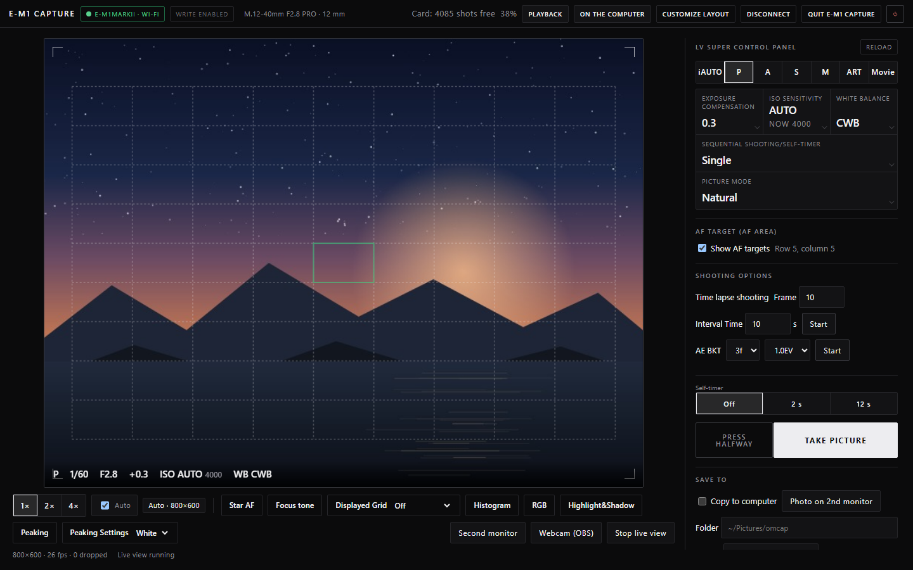
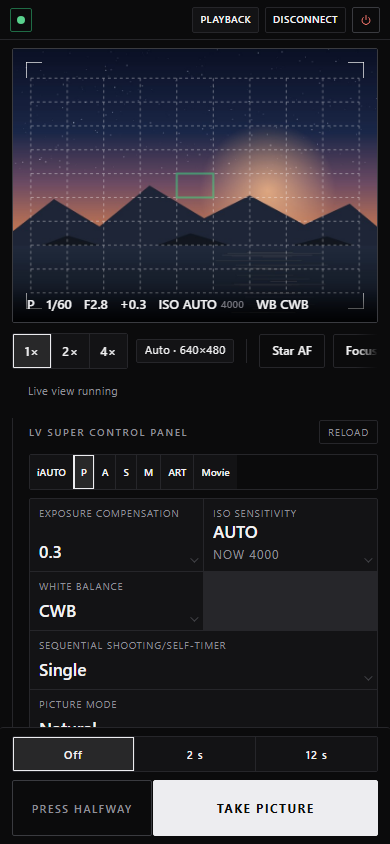

# E-M1 Capture

**Control your Olympus OM-D from the computer – over the camera's own Wi-Fi or a USB cable.**
Big live view, tap to focus, all main settings, playback and saving to the computer – in the browser, on
your own computer, without the internet.

Built and tested on the **E-M1 Mark I**; the **E-M1 Mark II** works over Wi-Fi and USB as well (see
[E-M1 Mark II](#e-m1-mark-ii) below). A user runs it with the **PEN-F**.

> Unofficial project. Not affiliated with, endorsed by or supported by OM Digital Solutions or Olympus.
> "Olympus", "OM-D" and "OI.Share" are trademarks of their respective owners. Use at your own risk.



*The interface after the 2026-11-24 redesign: one flat dark surface, hairline rows, white selection,
green for focus, red only for recording. Every setting tile is one control – click anywhere on it.*

## Highlights

- **Live view at 30 fps** over USB and Wi-Fi, sizes up to 1280×960, with histogram, Highlight&Shadow,
  peaking and grid.
- **Tap to focus** on the camera's own AF grid; green frame when it is sharp.
- **Super control panel** built from the body's own property table, so it shows what the camera can
  actually do in the current mode.
- **Shoot**: shutter, half press, self-timer, BULB / LIVE TIME / LIVECOMP, time lapse, AE bracketing,
  movie.
- **Playback** with index and calendar, shooting data, save to the computer.
- **Phone view**: start with `--lan`, click **Phone**, scan the QR code – the computer stays connected to
  the camera, the phone stays in the home Wi-Fi.
- **Webcam for OBS**, second monitor, HSL colour profiles, Star AF, level gauge (USB).
- **Safe by default**: never touches firmware, starts read-only, works offline, listens on 127.0.0.1 only.

## What changed (2026-11-24)

**E-M1 Mark II support**

- Over **USB**: 38 operations, 282 properties, live view 320×240 … 1280×960 at ~15 fps, change poll in
  5 ms, settings read, half and full press, card listing.
- Over **Wi-Fi**: 38 CGIs (a superset of the Mark I's 23), 54 properties, live view 30 fps at 320×240 and
  ~28 fps at 640×480, tap-to-focus in ~430 ms, half press in ~943 ms, shooting, playback and saving.
- Three Mark II differences found and handled: `get_camprop` answers **only in REC mode** (the settings
  panel now switches to REC by itself when writing is allowed and explains itself when not); live view
  frames end with an extra `AddIndex` block (the JPEG is trimmed at its last EOI); `get_unusedcapacity`
  answers `0xFFFFFFFF` before the card is mounted (shown as "unknown", not 4.2 GB).
- The body caps its Wi-Fi stream at about **1 MB/s**, so 640×480 is the stable size; 800×600 sits at the
  edge and oscillates. Full numbers: [`tools/mk2/wifi-results.md`](tools/mk2/wifi-results.md).

**Windows**

- USB works through the app's own PTP layer (`--usb-backend ptp` is the default on Windows); libgphoto2
  has no Windows build and is not used there.
- Fixed: a second start could bind the same port (Windows `SO_REUSEADDR` semantics), `killall ptpcamerad`
  ran on Windows, the start screen said "not found" without libgphoto2, settings files were read with the
  ANSI code page, "Open in OM Workspace" only worked on macOS.

**Interface** – rebuilt in the OM System direction:

- Flat, dark, square: hairlines instead of cards and shadows, one neutral scale.
- Selection is a light wash plus a white hairline (not a coloured block); green marks focus/connection,
  red only marks recording.
- The whole setting tile is the control – before, only the small value line opened the list.
- Consistent sizes: 34 px rows, 28 px header buttons, 58 px tiles; tabular numbers so values do not jump.
- Phone layout: one scrolling header row, two columns of tiles, shutter bar fixed at the bottom.

<p align="center"></p>

## Tested

| | E-M1 Mark I | E-M1 Mark II |
|---|---|---|
| Wi-Fi connect, live view | tested | tested, 30 / ~28 / ~13 / ~8 fps at 320 / 640 / 1024 / 1280 |
| Tap to focus, half press | tested | tested, 430 ms / 943 ms |
| Take picture, playback, save | tested | tested |
| Super control panel read / write | tested | tested (read needs REC mode) |
| USB live view | tested | tested (320×240 … 1280×960, ~15 fps) |
| USB mode dial, focus ring, zoom AF, focus stacking | tested | mode dial + shutter tested; the rest untested |
| Windows | not tested | Wi-Fi and USB tested |
| Phone view | tested | server side tested; on a phone untested |

Unit tests: **649 pass, 113 skipped**, no camera needed
(`.venv\Scripts\python -B -m unittest discover -s tests` on Windows).

## Quick start

```sh
git clone https://github.com/HolmHaensel/omcap.git
cd omcap
python3 -m venv .venv
.venv/bin/pip install -e .            # Wi-Fi only
.venv/bin/pip install -e ".[usb]"     # plus USB (macOS/Linux; on Windows add libusb-package)
```

Windows: `py -m venv .venv` and `.venv\Scripts\pip install -e .` then `.venv\Scripts\pip install libusb-package`.

Start with `E-M1 Capture.command` (macOS) or `E-M1 Capture.bat` (Windows), or
`.venv/bin/em1-capture --allow-write`. The browser opens at `http://127.0.0.1:8765`.

## Using Wi-Fi

1. Camera: **Setup → Wi-Fi Settings → Wi-Fi Connect Settings → Private** (once).
2. Camera: **Playback → Connection to Smartphone** – the monitor shows SSID and password.
3. Computer: join that network (it has no internet).
4. Start the app and choose **Wi-Fi connection**.

Mark II notes:

- The property table answers only in **REC mode**. Start live view once (the app does it by itself when
  started with `--allow-write`); in a read-only start the panel says what to do.
- **640×480** is the stable live view size; 800×600 is at the body's ~1 MB/s limit.
- Saving a picture from the card runs at about 0.27 MB/s.
- Live view arrives as UDP on port 5555. Allow it in the firewall (Windows asks, or add a rule for the
  venv's `python.exe`), otherwise the picture stays black while everything else works.

## Using USB

Camera: USB mode **Auto**, then choose the **computer + camera** entry on the monitor. On the Mark II this
is the row below `PC RAW` – **MTP** is a bare MTP responder and `Storage` is mass storage; neither can be
controlled.

- macOS/Linux: `pip install ".[usb]"`. Windows: `pip install libusb-package` and bind the camera to
  **WinUSB** with [Zadig](https://zadig.akeo.ie) – the binding is **per product id**, so repeat it after
  switching USB modes.
- `--usb-backend auto|ptp|gphoto2` chooses the USB layer; `auto` (macOS) falls back to libgphoto2,
  Windows always uses the own PTP layer.
- The Mark II must be in the camera+monitor mode: 38 operations means control, 20 means the wrong mode.

## Phone

Start with `--lan`, click **Phone** on the computer and scan the QR code. The phone gets a key that lasts
12 hours; the computer keeps the camera, the phone stays in the home Wi-Fi. The phone layout picks its own
live view size, hides the second-monitor and webcam windows, and supports pinch-zoom and swipe in playback.

## Options

| Option | What it does |
|---|---|
| `--allow-write` | allow shooting and settings (default: read only) |
| `--lan` | open the app for a phone in the home network (QR code + key) |
| `--usb-backend auto\|ptp\|gphoto2` | USB layer; Windows always uses `ptp` |
| `--data-dir DIR` | where pictures and caches are stored (default: current folder) |
| `--host IP` | camera address in its Wi-Fi (default `192.168.0.10`) |
| `--port N`, `--no-browser`, `--timing` | web port, no browser, per-request timing |

## Safety

- Never writes firmware. Starts read-only; shooting and settings need `--allow-write`.
- Listens on `127.0.0.1` only (with `--lan` also in the home network, with a per-start key) and refuses
  requests from other web pages.
- Works offline; the internet is needed once, for the installation.

## Development

```
.venv/bin/python -B -m unittest discover -s tests
```

`tools/` has the read-only probes used for the Mark II work (`win_probe.py`, `usb_enum.py`,
`ptp_probe.py`, `mk2_suite.py`); `tools/mk2/` holds the body's command list, property table and the Wi-Fi
report. GPL-3.0-or-later, see [LICENSE](LICENSE).
